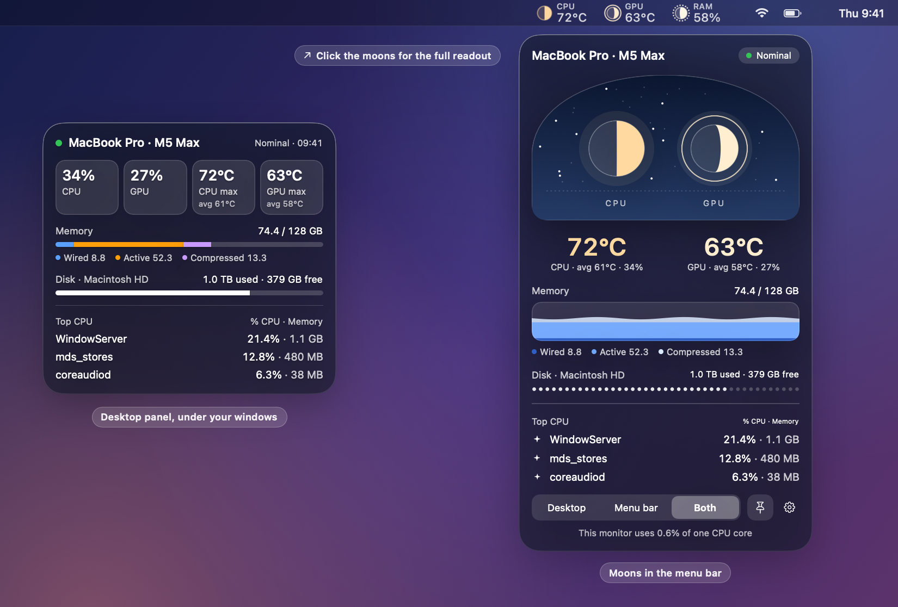
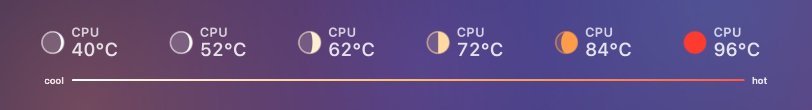

# Little Moon

*Mac stats at a glance*



Know when your Mac is working hard: CPU and GPU temperature and RAM use at a glance, for under 1% of one CPU core.



## Tips

- **Right-click the moons or the desktop panel** for settings: Display (Desktop, Menu bar or Both), Size (Large or Medium), Temperature (°C or °F), Language (English or 繁體中文), and which moons to show (CPU, GPU, RAM). Show Tour replays the first-run tour.
- **Click the moons** for the popover: peak and average temperatures, CPU and GPU load, memory, disk, the top three processes and the thermal state.
- **No made-up numbers.** When a reading is a fallback, Little Moon shows "estimated" (≈, dashed moon). When it has none, it says "unavailable".

## Install

Requires macOS 26 Tahoe or later and Apple Silicon.

1. Download `LittleMoon-v0.4.0.dmg` from [Releases](https://github.com/felixfu824/little-moon-stat/releases/latest). It is signed and notarized by Apple.
2. Open it and drag **Little Moon** into **Applications**.
3. Launch it. A short tour shows you around once.

Little Moon has no Dock icon. Right-click the moons to quit.

Build from source:

```
Scripts/build.sh
open build/MacMonitorPanel.app
```

## Testing limitation

- Tested on two Macs only: a MacBook Pro (M5 Max, macOS 26.7.1) and a MacBook Air (M3, macOS 26.6.2).
- Other Apple Silicon chips (M1, M2, M4 and their Pro, Max and Ultra variants) use sensor maps checked against public sensor dumps, not on real hardware. If a map does not fit your chip, Little Moon falls back to a generic sensor set and marks the reading "estimated".
- Not yet tested: Mac desktops (Mac mini, iMac, Mac Studio, Mac Pro), multiple displays, and full VoiceOver use.
- Intel Macs and macOS 15 or earlier are not supported.

## Credits

Thanks to the projects whose sensor and sampling approaches informed this app.

- [exelban/stats](https://github.com/exelban/stats) (MIT): its per-chip SMC temperature key lists (`Modules/Sensors/values.swift`) were the starting point for our CPU and GPU sensor maps. Its issue tracker also informed our macOS 26 menu-bar caveats.
- [vladkens/macmon](https://github.com/vladkens/macmon) (MIT): the generic fallback idea (any `Tp` or `Te` key as CPU, `Tg` as GPU, within a sane range) that our "estimated" fallback follows.
- [dkorunic/iSMC](https://github.com/dkorunic/iSMC) (GPL-3.0): its 27 public SMC dumps and labelled key map were used to audit our per-chip maps across Apple Silicon generations. Test fixtures were derived locally; no iSMC files are in this repo.
- [narugit/smctemp](https://github.com/narugit/smctemp): consulted as a further sensor map.
- [jundot/omlx](https://github.com/jundot/omlx) (its menu-bar `SystemStatsSampler`): the approach for CPU and GPU utilisation and memory sampling (`host_processor_info`, IOAccelerator, `host_statistics64`).

## License

[MIT](LICENSE)
